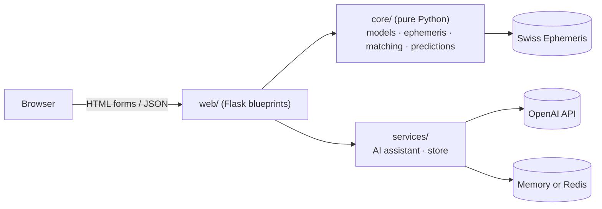

# 🔮 Vedic Astrology AI

> A production-ready Flask application for **Vedic (Jyotish) astrology**: sidereal birth charts, Panchanga, Guna Milan kundali matching, rule-based predictions with remedies, and an OpenAI-powered "Cosmic Sage" chat assistant.

[](https://github.com/Gayathri-Reddy874/vedic-astrology-ai/actions/workflows/ci.yml)


---

## ✨ Features

| Area | What you get |
|---|---|
| **Birth chart** | Sun to Saturn plus Rahu/Ketu, sign, degree, nakshatra and pada, retrograde flag, Lagna and 12 houses, all in the **Lahiri sidereal** zodiac via the Swiss Ephemeris |
| **Panchanga** | Tithi (with Paksha), Nakshatra, **Yoga** and **Karana** |
| **Kundali matching** | Eight-koota Guna Milan out of 36, Manglik check, compatibility band; optional birth time |
| **Predictions** | Personality, career, relationships, spiritual, health and challenge signals with matching remedies |
| **AI astrologer** | "Cosmic Sage" chat grounded in your chart, with per-session memory, suggested questions and clear-chat |
| **JSON API** | `/api/horoscope`, `/api/chat`, `/api/chat/suggestions`, `/health` |
| **Operations** | Input validation, request IDs, structured logs, rate limiting, security headers, Docker, CI |

## 🏗️ Architecture



```
vedic-astrology-ai/
├── vedic_astro/
│   ├── __init__.py          # create_app(): config, hooks, error handlers
│   ├── config.py            # environment-driven Settings
│   ├── extensions.py        # rate limiter
│   ├── core/                # framework-free domain logic (easy to test)
│   │   ├── constants.py     # signs, nakshatras, koota tables
│   │   ├── models.py        # BirthData with validation
│   │   ├── ephemeris.py     # sidereal chart + Panchanga
│   │   ├── matching.py      # Guna Milan + Manglik
│   │   └── predictions.py   # signals and remedies
│   ├── services/
│   │   ├── ai_assistant.py  # OpenAI v1 client, prompt, history
│   │   └── store.py         # MemoryStore / RedisStore with TTL
│   └── web/
│       ├── pages.py         # HTML routes (same templates as before)
│       ├── api.py           # JSON routes
│       └── helpers.py       # per-visitor server-side state
├── templates/  static/      # unchanged UI
├── tests/                   # pytest suite
├── wsgi.py  app.py          # gunicorn / local entry points
├── Dockerfile  docker-compose.yml  Makefile  pyproject.toml
└── .github/workflows/ci.yml
```

**Design decisions**

- **Core is Flask-free.** Astrology logic takes validated `BirthData` and returns plain dicts, so it is unit-testable and reusable.
- **App factory + environment config.** Production refuses to start without `SECRET_KEY`.
- **Server-side chart context.** The session cookie holds only an opaque id; the chart, predictions and chat history live in a TTL store (memory, or Redis when `REDIS_URL` is set), avoiding the 4 KB cookie limit.
- **Errors never leak.** Provider and internal exceptions are logged with a request ID and replaced by generic messages.

## 🚀 Quick start

```bash
git clone https://github.com/Gayathri-Reddy874/vedic-astrology-ai.git
cd vedic-astrology-ai
make install                 # creates .venv and installs dev dependencies
cp .env.example .env         # add OPENAI_API_KEY to enable the chat
make run                     # http://127.0.0.1:5000
```

The chart, matching and predictions work without an OpenAI key; only the chat needs one.

### Docker

```bash
cp .env.example .env         # set SECRET_KEY (required in production) and OPENAI_API_KEY
docker compose up --build    # web on :8000 with Redis for shared state
```

Running over plain HTTP in Safari? Set `COOKIE_SECURE=0` in `.env`.

## ⚙️ Configuration

| Variable | Default | Purpose |
|---|---|---|
| `APP_ENV` | `development` | `development`, `production` or `testing` |
| `SECRET_KEY` | random in dev | **Required** in production |
| `OPENAI_API_KEY` | none | Enables the AI chat |
| `OPENAI_MODEL` | `gpt-4o-mini` | Chat model |
| `REDIS_URL` | none | Shared state and rate-limit storage across workers |
| `CHAT_RATE_LIMIT` | `20 per minute` | Per-IP limit on `/api/chat` |
| `SESSION_LIFETIME` | `3600` | Seconds a visitor's chart and chat context are kept |
| `COOKIE_SECURE` | on in production | Send the session cookie over HTTPS only |
| `TRUST_PROXY` | `0` | Honour `X-Forwarded-*` behind a trusted proxy |
| `LOG_LEVEL` | `INFO` | Logging level |

> With more than one worker you **must** set `REDIS_URL`, otherwise each worker keeps its own chat state.

## 🧭 Routes

| Route | Method | Description |
|---|---|---|
| `/` · `/about` · `/compatibility` · `/ai-chat` | GET | Pages |
| `/chart` | POST | Chart, predictions and remedies |
| `/match` | POST | Guna Milan result |
| `/predictions` | GET | Predictions for your last chart |
| `/api/horoscope` | POST | Chart as JSON |
| `/api/chat` | POST | `{"message": "..."}` → AI reply (rate limited) |
| `/api/chat/clear` · `/api/chat/suggestions` | POST · GET | Chat utilities |
| `/health` | GET | Liveness probe |

```bash
curl -X POST http://127.0.0.1:5000/api/horoscope \
  -H "Content-Type: application/json" \
  -d '{"year":2000,"month":1,"day":1,"hour":10,"minute":30,
       "latitude":12.9716,"longitude":77.5946,"timezone":5.5}'
```

`timezone` is the UTC offset in hours (default `5.5`). Invalid input returns `400` with `{"success": false, "error": "..."}`.

For `/match`, `boy_hour`/`boy_minute` and `girl_hour`/`girl_minute` are optional (default 12:00) but improve the Moon position, which moves about a nakshatra per day.

## 🧪 Development

```bash
make test      # pytest with coverage (gate: 85%)
make lint      # ruff check + format check
make format    # auto-fix
```

The suite covers input validation, sidereal sanity checks (Sun, Rahu, Lagna), Panchanga boundaries, each koota rule, prediction rules, the AI service with a fake client, the stores, rate limiting, error handling and the API.

## 📐 Accuracy and limitations

| Component | Status |
|---|---|
| Planet, Lagna, node positions | Lahiri sidereal; Moshier ephemeris (no data files needed) |
| Houses | Whole-sign from the Lagna |
| Varna, Tara, Graha Maitri, Gana, Bhakoot, Nadi | Traditional rules |
| **Vashya, Yoni** | **Simplified** (group match and enemy pairs, not the full score matrices) |
| Predictions | Generic rule-based text, not a personal reading |
| Vara (weekday) | Not yet included |

Planned: full Vashya/Yoni matrices, Vimshottari Dasha, Navamsa, CSRF protection for the HTML forms.

## 📌 Disclaimer

For learning and entertainment. Astrological output is not scientific fact and must not drive medical, legal or financial decisions.

## 📄 License

[MIT](LICENSE) · **Mallareddygari Gayathri** · [GitHub](https://github.com/Gayathri-Reddy874) · [LinkedIn](https://linkedin.com/in/mallareddygari-gayathri)
