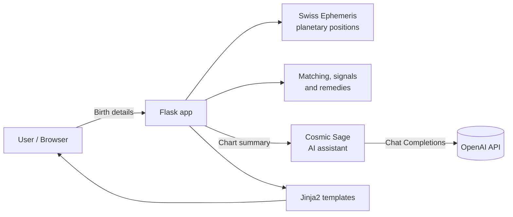

<div align="center">

# 🔮 Vedic Astrology AI

**Sidereal birth charts, Guna Milan kundali matching, rule-based predictions and an AI astrologer, in one production-ready Flask app.**

[](https://www.python.org/)
[](https://flask.palletsprojects.com/)
[](https://www.astro.com/swisseph/)
[](https://platform.openai.com/)
[](Dockerfile)
[](tests/)
[](LICENSE)

</div>

---
---

## 📖 Table of Contents

- [Overview](#-overview)
- [Features](#-features)
- [Tech Stack](#️-tech-stack)
- [Architecture](#-architecture)
- [Project Structure](#-project-structure)
- [Getting Started](#-getting-started)
- [Docker](#-docker)
- [Configuration](#️-configuration)
- [Routes and API](#-routes-and-api)
- [How It Works](#-how-it-works)
- [Development](#-development)
- [Limitations](#️-limitations)
- [Roadmap](#️-roadmap)
- [Contributing](#-contributing)
- [Security](#-security)
- [Disclaimer](#-disclaimer)
- [License](#-license)
- [Author](#-author)

---

## 🌟 Overview

**Vedic Astrology AI** combines traditional Jyotish calculations with a conversational AI assistant. Enter a date, time and place of birth and the app computes a sidereal chart using the **Swiss Ephemeris** and the **Lahiri ayanamsa**, then generates predictions and remedies from it. The **Cosmic Sage** chat assistant answers follow-up questions grounded in *your* chart rather than generic horoscope text.

Chart generation and kundali matching run fully offline. Only the AI chat needs an OpenAI API key.

---

## ✨ Features

### 🪐 Birth Chart (Kundali)
- Positions of **Sun, Moon, Mars, Mercury, Jupiter, Venus, Saturn, Rahu and Ketu**
- Rashi (Sanskrit and English names), degree, **Nakshatra and Pada**
- **Ascendant (Lagna)** and a **12-house** layout
- **Panchanga** summary (Tithi and Nakshatra)
- Sidereal zodiac using the **Lahiri ayanamsa**

### 💞 Kundali Matching (Guna Milan)
- Eight-koota scoring out of **36 points**: Varna, Vashya, Tara, Yoni, Graha Maitri, Gana, Bhakoot, Nadi
- **Manglik** check for both partners
- Overall compatibility band, from *Excellent* to *Not Recommended*

### 📜 Predictions and Remedies
- Rule-based signals from planetary house placements covering personality, career, relationships, spiritual growth, health focus areas, challenges and life purpose
- Matching remedies (mantras, charity, practices) for each detected signal

### 🤖 Cosmic Sage, the AI Astrologer
- Persona built on the OpenAI Chat API
- Responses grounded in your generated chart, predictions and remedies
- Per-session conversation memory, quick-start question suggestions and a clear-chat endpoint

### 🔌 JSON API
- Chart data and chat exposed through simple REST endpoints

### 🏭 Engineering
- Modular package layout, automated tests, Docker and Docker Compose support
- WSGI entry point for production servers
- Dev tooling configured through `pyproject.toml` and a `Makefile`

---

## 🛠️ Tech Stack

| Layer | Tools |
|-------|-------|
| Backend | Python, Flask |
| Astronomy | `pyswisseph` (Swiss Ephemeris), Lahiri ayanamsa |
| AI | OpenAI Chat Completions |
| Frontend | Jinja2 templates, HTML/CSS |
| Config | `python-dotenv` |
| Testing | `pytest` |
| Packaging and tooling | `pyproject.toml`, `Makefile` |
| Deployment | Docker, Docker Compose, WSGI |

---

## 🏗️ Architecture



The chart summary produced by the calculation layer is injected into the assistant's system prompt, so every chat answer is personalised to the user's own chart.

---

## 📁 Project Structure

```
vedic-astrology-ai/
├── vedic_astro/            # Core package: calculations, matching, predictions, AI assistant
├── templates/              # Jinja2 pages (home, chart, matching, AI chat, about)
├── static/css/             # Stylesheets
├── tests/                  # Automated test suite
├── app.py                  # Flask application entry point
├── wsgi.py                 # WSGI entry point for production servers
├── Dockerfile              # Container image
├── docker-compose.yml      # Local container orchestration
├── Makefile                # Common developer commands
├── pyproject.toml          # Project metadata and tool configuration
├── requirements.txt        # Runtime dependencies
├── requirements-dev.txt    # Development and test dependencies
├── CHANGELOG.md            # Release history
├── CONTRIBUTING.md         # Contribution guidelines
├── SECURITY.md             # Security policy
└── LICENSE
```

---

## 🚀 Getting Started

### Prerequisites
- Python **3.9+**
- An OpenAI API key (optional, only for the AI chat)

### 1. Clone and install

```bash
git clone https://github.com/Gayathri-Reddy874/vedic-astrology-ai.git
cd vedic-astrology-ai

python -m venv venv
source venv/bin/activate        # Windows: venv\Scripts\activate

pip install -r requirements.txt
```

### 2. Configure environment variables

Create a `.env` file in the project root:

```env
OPENAI_API_KEY=your-openai-api-key
SECRET_KEY=change-this-to-a-long-random-string
```

### 3. Run

```bash
python app.py
```

Open **http://localhost:5000** in your browser.

### Production server

```bash
gunicorn wsgi:app --bind 0.0.0.0:8000
```

---

## 🐳 Docker

```bash
# Build and start with Docker Compose
docker compose up --build

# Or build and run the image directly
docker build -t vedic-astrology-ai .
docker run --env-file .env -p 5000:5000 vedic-astrology-ai
```

---

## ⚙️ Configuration

| Variable | Required | Description |
|----------|----------|-------------|
| `OPENAI_API_KEY` | Only for AI chat | Your OpenAI API key. Without it the app still starts; the chat endpoint returns a "service unavailable" message. |
| `SECRET_KEY` | Yes | Flask session secret. Use a long random string and never commit it. |

> 🔒 Keep `.env` out of version control and never bake secrets into the Docker image.

---

## 🧭 Routes and API

| Route | Method | Description |
|-------|--------|-------------|
| `/` | GET | Birth details form |
| `/chart` | POST | Generate chart, predictions and remedies |
| `/compatibility` | GET | Kundali matching form |
| `/match` | POST | Guna Milan result |
| `/ai-chat` | GET | AI astrologer chat UI |
| `/about` | GET | About page |
| `/api/horoscope` | POST | Chart data as JSON |
| `/api/chat` | POST | Send a message to the AI astrologer |
| `/api/chat/clear` | POST | Clear conversation history |
| `/api/chat/suggestions` | GET | Suggested questions |

### Example: horoscope API

```bash
curl -X POST http://localhost:5000/api/horoscope \
  -H "Content-Type: application/json" \
  -d '{
        "year": 2000, "month": 1, "day": 1,
        "hour": 10, "minute": 30, "second": 0,
        "latitude": 12.9716, "longitude": 77.5946,
        "timezone": 5.5
      }'
```

`hour` is local time in 24-hour format. `timezone` is the offset from UTC in hours (default `5.5`, IST).

---

## 🧮 How It Works

1. **Time conversion**: local birth time is converted to UTC, then to a Julian Day.
2. **Positions**: the Swiss Ephemeris returns planetary longitudes, which are converted to sign, degree, Nakshatra (27 × 13°20′) and Pada.
3. **Panchanga**: Tithi is derived from the Moon–Sun longitude difference in 12° steps.
4. **Matching**: each partner's Moon Nakshatra and Rashi feed the eight kootas, summed to a score out of 36.
5. **Predictions**: house placements of key planets trigger rules that produce the signals and remedies on the chart page.
6. **AI chat**: a summary of the chart is added to the system prompt so answers are personalised.

---

## 🧪 Development

```bash
# Install runtime and dev dependencies
pip install -r requirements.txt -r requirements-dev.txt

# Run the test suite
pytest
```

The `Makefile` wraps the common tasks. Run `make help` (or open the file) to see the available targets.

---

## ⚠️ Limitations

- Several kootas (Vashya, Tara, Bhakoot, Nadi) use **simplified rules**, and matching currently uses the birth **date** only (Moon taken at noon), so results are indicative rather than traditional-grade.
- Yoga and Karana in the Panchanga are placeholders.
- Predictions are generic, rule-based text, not a substitute for a professional reading.
- Chat history is held in server memory and resets on restart.

---

## 🗺️ Roadmap

- [ ] Full traditional koota tables and birth-time-aware matching
- [ ] Complete Panchanga (Yoga, Karana, Vara)
- [ ] Vimshottari Dasha timeline
- [ ] Divisional charts (Navamsa)
- [ ] Persistent chat storage
- [ ] GitHub Actions CI and cloud deployment

---

## 🤝 Contributing

Contributions, issues and feature requests are welcome. Please read [CONTRIBUTING.md](CONTRIBUTING.md) before opening a pull request, and see the [CHANGELOG](CHANGELOG.md) for release history.

---

## 🔐 Security

To report a vulnerability, please follow the process in [SECURITY.md](SECURITY.md) rather than opening a public issue.

---

## 📌 Disclaimer

This project is built for **learning and entertainment**. Astrological output is not scientific fact and must not be used for medical, legal or financial decisions.

---

## 📄 License

Released under the [MIT License](LICENSE).

---

## 👩‍💻 Author

**Mallareddygari Gayathri**

[GitHub](https://github.com/Gayathri-Reddy874) · [LinkedIn](https://linkedin.com/in/mallareddygari-gayathri)

⭐ If you found this project useful, consider giving it a star.
